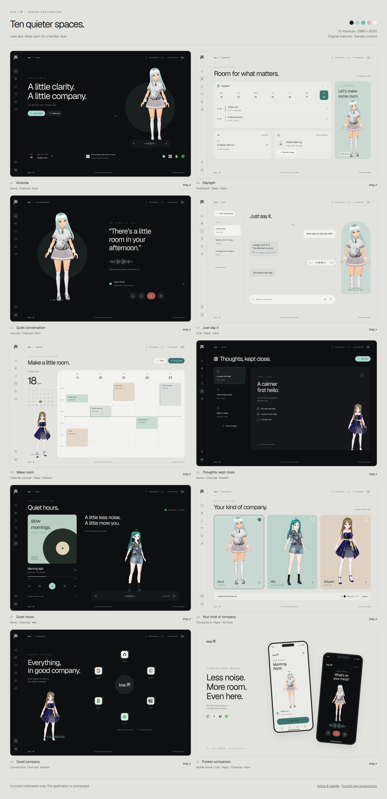
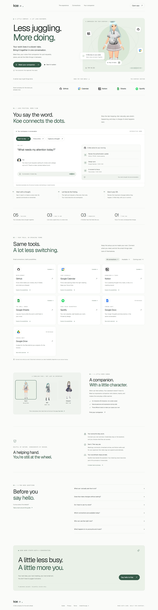
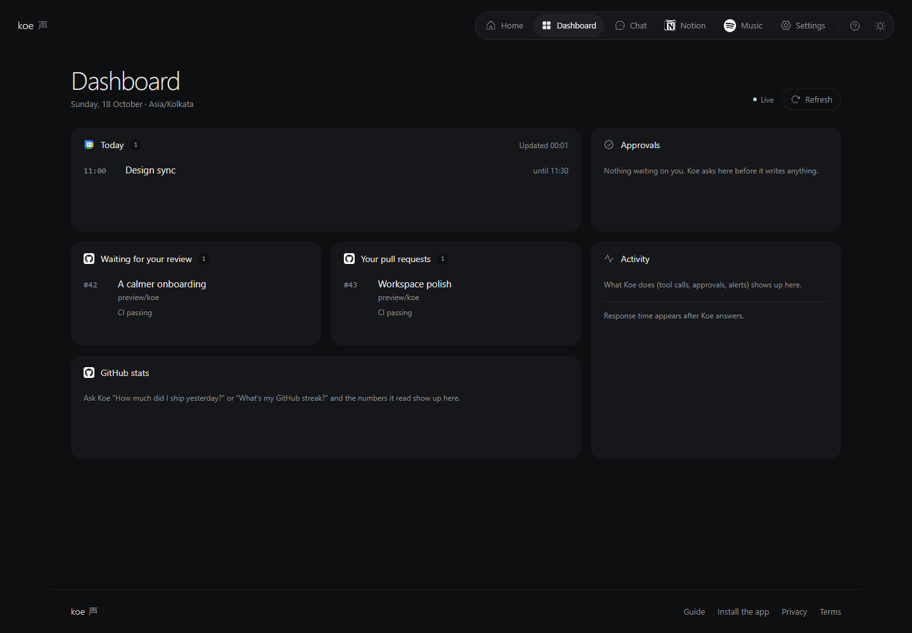
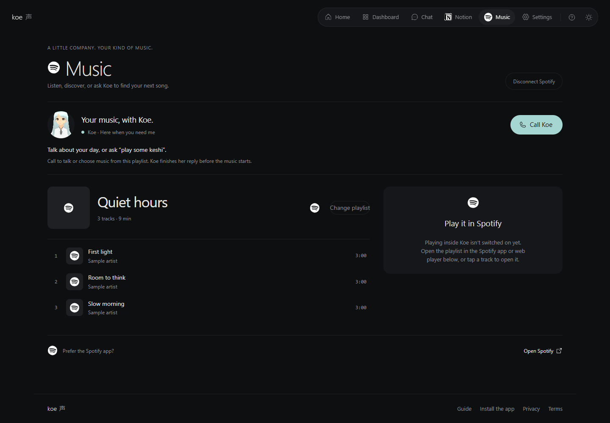

# Koe (声)

**A voice-first companion for your workday.** Talk to Kami, Mei, or Kobashi in a live call, send a message or voice note, and bring GitHub, Google Calendar, Google Docs, Google Sheets, Notion, and your music into one place. Koe previews consequential changes and waits for your approval.



> This contact sheet shows **design concepts**, not the running application. Events, accounts and playback shown in the concepts and screenshots are illustrative. [Actual application captures](#application-screenshots) appear below.

## Feature status

Source/Graphify inventory on **18 October 2026**. “Implemented” means the code and UI path exist; it does not assert fresh end-to-end or live-provider acceptance.

| Area | Implemented | Still needed or limited |
| --- | --- | --- |
| Conversation | Live web voice call with a 3D mascot, text chat, recorded voice notes, dashboard, installable mobile web app, and push path | Physical-phone microphone and notification acceptance remains separate. |
| GitHub | Per-person OAuth and repo selection; review queue, PR/CI views and summaries; yesterday’s commits and merged PRs; linked commit detail, activity/streak statistics; approved PR comments | Real-account chat and voice answers still need comparison with GitHub after deployment. No merge tool. |
| Google Calendar | Free-time/event reads, approved create/move/cancel, bounded recurrence and all-day support, reminders and Meet requests | Real consent and an approved booking on a test calendar await acceptance. |
| Google Docs | Optional consent, app-accessible search, read by link/ID, approved plain-text create/append/exact replacement with revision checks | Live deployment, real consent and Google writes remain unverified. No full Drive manager or rich-text editor. |
| Google Sheets | Timesheet creation, schema/row reads, approved hour logging, new columns and row edits | Requires a configured Google grant and sheet; live account acceptance is separate. |
| Notion | Owner-connected workspace: search, tasks, notes, meeting records, daily logs, schema, approved edits/trash | The agent integration is owner-scoped; per-person public Notion OAuth is not implemented. |
| Spotify Music | Optional OAuth, playlist selection/creation, search, playback controls, compact music assistant and gated voice controls | Requires provider configuration and eligible account/device/playlist. Audible desktop/mobile acceptance and music-page latency work remain. |
| WhatsApp | Webhook, text/voice-note handling, approval replies and GitHub-alert path | Real sending and alert delivery depend on Meta business/template setup. |

Every provider is optional during initial local setup. The server holds provider credentials; the browser does not. Approval proposals are persisted for consequential writes; the owner’s append-only Notion daily log is the documented exception. [Product contract](docs/SPEC.md) · [Remaining acceptance work](tasks/todo.md).

## Application screenshots

These are captures of the **running UI** with isolated, synthetic account/API responses. They demonstrate the layout, not a live provider transaction.

| Landing | Dashboard | Music |
| --- | --- | --- |
|  |  |  |

[See all 15 application captures](design/koe-mockups-2026-10-17/screenshots/current/) for Home, Chat, Notion, Settings, Call and mobile views. The [10-screen mockup gallery](design/koe-mockups-2026-10-17/README.md) contains full-resolution PNGs and editable HTML/CSS. Its separate Calendar page is a **concept**, not an existing app route. [Five experimental brand images](design/koe-experiments-2026-10-18/README.md) explore the mascot identity; they are not shipped UI or hardware.

## Install and run locally

**Prerequisites:** Python **3.12+**, [uv](https://docs.astral.sh/uv/), Node.js/npm compatible with the checked-in lockfile, and a Gemini API key. Neon PostgreSQL and external provider credentials are needed for their corresponding connected workflows. Keep secrets in `backend/.env`; never put them in a `VITE_` variable or commit them.

```powershell
git clone https://github.com/watermelon588/Koe.git
cd "Koe"
Copy-Item backend/.env.example backend/.env
Copy-Item frontend/.env.example frontend/.env.local
# Set GEMINI_API_KEY in backend/.env. Configure DATABASE_URL for persisted
# approvals/accounts, then the OAuth variables for services you want to connect.
cd backend
uv sync
uv run python -m scripts.migrate_store  # once DATABASE_URL is configured
uv run uvicorn koe.main:app --reload --port 8000
```

In a second terminal, from the repository’s `frontend/` folder:

```powershell
npm ci
npm run dev
```

Open `http://localhost:5173`. The backend health endpoint is `http://localhost:8000/health`. Vite proxies `/api`, `/auth` and `/ws` to port 8000. If you are viewing only the landing page, you can defer provider configuration. Calls need Gemini; approval-backed workflows need the migrated database. [`backend/.env.example`](backend/.env.example) lists each setting; [`frontend/.env.example`](frontend/.env.example) documents the optional backend URL override.

For account sign-in, create a **Google Web OAuth client**, add `http://localhost:5173/auth/google/callback`, and set `GOOGLE_WEB_CLIENT_ID`, `GOOGLE_WEB_CLIENT_SECRET`, `KOE_SECRET_KEY` (32+ random characters), `KOE_PUBLIC_URL` and your admin email in `backend/.env`. Add your Google account as a test user while the consent app is in Testing. The older owner-only desktop-client setup is documented separately in [Phase 2 setup](docs/PHASE2_SETUP.md).

### Connect the tools

1. **GitHub:** create an OAuth App with callback `http://localhost:5173/auth/github/callback`; set `GITHUB_CLIENT_ID` and `GITHUB_CLIENT_SECRET`; then choose **Settings → Connections → GitHub → Connect → Choose repositories**. [Workflow](docs/GITHUB_WORKFLOW.md).
2. **Calendar and Sheets:** enable their APIs in the Google project, grant the requested scopes, then connect in Settings. Configure an existing timesheet with `GOOGLE_SHEETS_ID`/tab or use Koe’s creation flow. [Google setup](docs/PHASE2_SETUP.md) · [Sheets setup](docs/PHASE4_SETUP.md).
3. **Docs:** enable the Docs and Drive APIs, add `documents` and `drive.file` scopes, then choose **Settings → Connections → Google Docs → Enable Docs**. Existing Google users must grant these additional permissions. [Docs setup and limits](docs/GOOGLE_DOCS.md).
4. **Notion:** configure an internal integration, share its database with it, then set `NOTION_TOKEN` and `NOTION_DATABASE_ID`. [Setup](docs/PHASE4_SETUP.md).
5. **Spotify:** set its OAuth client ID/secret, registered callback and `SPOTIFY_ENABLED`; approved voice use also needs `SPOTIFY_VOICE_APPROVED` and playlist permission. Connect from Music. [Music architecture and setup](docs/SPOTIFY_MUSIC_ARCHITECTURE.md) · [voice-control contract](docs/spotify/VOICE_CONTROL.md).
6. **WhatsApp / push:** configure Meta webhook values and a VAPID identity only if you need these channels. [Deployment guide](docs/DEPLOY.md).

Deploy the backend and frontend **together** and configure the corresponding HTTPS callback URLs and server-side secrets. [Render/Vercel deployment](docs/DEPLOY.md) covers webhooks and environment variables. A successful build or `/health` response alone does not prove a provider connection works.

## Architecture

```text
Browser / installed mobile web app
  ├─ React + Vite: home, dashboard, call, chat, Notion, Music, settings
  ├─ HTTPS /api and /auth ───────────────┐
  └─ WebSockets /ws/call and /ws/events ─┤
                                        ▼
                                FastAPI backend
                         Gemini Live + text agent
                       tool registry + approval gate
                            │             │
                            │             └─ Neon PostgreSQL: accounts,
                            │                connections, chat, activity, approvals
                            └─ GitHub · Google · Notion · Spotify APIs
                     Meta/GitHub webhooks → events and alerts
```

The backend checks identity and provider scope, gives bounded evidence to the agent, and executes approved writes. Spotify playback uses the separate music service; track metadata stays out of model prompts. [Detailed architecture](docs/ARCHITECTURE.md) · [Technology choices](docs/TECH_STACK.md).

```text
backend/
  koe/              FastAPI routes, auth, agent, approvals, provider services
    tools/           Bounded GitHub, Calendar, Docs, Sheets, Notion tools
  migrations/       PostgreSQL schema changes
  scripts/          OAuth, migration and operator helpers
  tests/            Backend and focused browser checks
frontend/
  src/              React pages, mascot, dashboard, Music, settings
  public/           PWA and static assets
  tests/            UI and state checks
design/             Current-app captures and separate visual concepts
docs/               Contract, setup, architecture and build log
tasks/              Remaining acceptance work
render.yaml         Backend host blueprint
```

## Development checks

From `backend/`, run `uv run pytest -q`. From `frontend/`, run `npm test`, `npm run lint` and `npm run build`. These checks do not replace real Google/GitHub/Spotify/Meta consent and device tests. This README revision was a focused source/Graphify audit only; no end-to-end test was run for it.

[Plan](docs/PLAN.md) · [Build log](docs/BUILD_LOG.md) · [Decisions](docs/DECISIONS.md)
