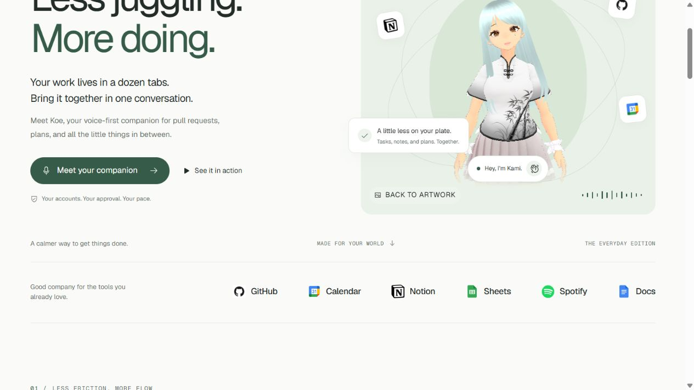

# Koe end-to-end audit — 26 October 2026

Repair follow-up: [27 October reliability repair](../../docs/RELIABILITY_REPAIR_2026-10-27.md). This audit describes the pre-repair state.

**Verdict: automated checks pass, but the configured local application does not pass full live acceptance.** Calendar/Sheets authorization, Docs permission, WhatsApp sending, call connectivity and latency need attention.

This audit covers the feature inventories in `README.md`, `docs/SPEC.md`, `docs/DETERMINISTIC_FEATURES.md`, `tasks/todo.md`, the landing page and Guide. It checks the local application, not a hosted deployment. Initial HEAD: `33557953fc5196c3a2a7723855e2c5b4476f782b`.

## Verification results

| Check | Result |
| --- | --- |
| Backend, final full run | **626 passed**, one Starlette/httpx deprecation warning; 158.43 seconds |
| Frontend | **75 passed**, no failed or skipped tests |
| Production TypeScript/Vite build | **Passed**; mascot chunk approximately 760 kB before gzip triggers a size warning |
| Lint | Completed; **four React warnings** in App, ChatPage, InstallPage and Connections |
| Real public browser | Landing, demos, service dialogs, three companions and public information pages exercised; no captured console warnings/errors |
| Live provider/API probes | 21 initial probes, plus targeted authorization, database, chat and WebSocket follow-ups; detailed below |

The initial backend run had 619 passes and one failure: a test expected 23 tool declarations, while the application exposes 29. While the audit was running, other workspace edits updated this assertion and added invited-user checks. The final complete run above includes those changes. I did not author those production/test changes; audit additions are confined to this artifact directory. The running backend was started before those concurrent source edits and was not hot-reloaded.

## Feature-by-feature status

“Synthetic pass” means the existing automated tests exercised application logic with isolated storage and simulated provider/model responses. It does **not** prove a fresh real-account transaction, browser interaction or audible result.

| Feature group | Automated evidence | Observed live result / remaining acceptance |
| --- | --- | --- |
| Google sign-in, invited users, sessions, account isolation, API authentication | Synthetic pass, including final invited-user tests | Sign-in screen renders. Invalid bearer tokens receive 401 from connections, Notion and owner diagnostics. Fresh Google sign-in/callback and invited-user UI were not completed. |
| Live voice call, typed text during calls, transcripts, mute/barge-in, tool calls | Synthetic pass | Direct Gemini Live audio probe produced nonempty audio. Actual `/ws/call` greeting failed twice with zero audio/transcripts; browser-equivalent retry closed 1011. Backend log shows `ConnectionResetError` during the upstream TLS connection to Gemini. Microphone, audible output, mute and interruption remain unverified on a real device. |
| Text chat, stored history, own Gemini key, fallback | Synthetic pass | Initial history GET exceeded the 45-second client budget; sequential retry returned 200 after **61.7 s**. Direct `gemini.generate` probe returned **503**. The actual app text/OpenRouter fallback conversation was not exercised live; do not infer that every chat request fails. |
| Recorded voice notes, spoken replies, shared conversation history | Synthetic pass | Real microphone upload, transcription, spoken reply and cross-channel memory acceptance were not completed. |
| Dashboard, events, approval/activity/latency panels | Synthetic pass | Authenticated `/ws/events` emits a snapshot and refreshed panels. Latest refresh: review queue, own PRs and yesterday activity returned without errors; Calendar returned an error. Real persisted approval/activity completeness remains affected by database timeouts. |
| GitHub OAuth/personal token, selected/all repositories | Synthetic pass | Existing owner credential works for reads. Connections reports `github_ready=false`, `github_token_ready=true`: OAuth setup and token-entry capability are distinct. Fresh consent/repository selection UI was not completed. |
| GitHub review queue, own PR/CI views, PR summaries and commit detail | Synthetic pass | Review queue and own PR tools returned successful responses. Contribution calendar/streak read succeeded. PR/commit summaries were not compared with a real source item through chat or voice. |
| GitHub yesterday/date-range history, per-repository counts and changed lines | Synthetic pass | Initial yesterday+lines request hit the **30-second total deadline**. Later dashboard yesterday read without line details succeeded. Treat as an intermittent/latency issue; the initial line-details path was not validated. |
| Approved GitHub comments | Synthetic proposal/approval/execute-once pass | No real comment posted. No merge tool is advertised as implemented. |
| Calendar listing/free time | Synthetic pass | Both live probes fail. Stored Google refresh returns **`invalid_grant`**. Reconnect required. |
| Calendar create/move/cancel, recurrence/all-day, details, reminders and Meet | Synthetic approval, stale/version, overlap, payload and uncertain-outcome tests pass | Blocked by the current invalid Google grant. No real events, invitations or cancellations performed; phone reminder delivery unverified. |
| Docs optional consent, app-accessible discovery and link/ID reads | Synthetic pass | Stored grant lacks both `documents` and `drive.file`; API reports `docs_ready=false`. Discovery fails with missing/expired Docs access. Enable Docs after reconnecting Google. |
| Docs create, append, exact replace, revision/account checks | Synthetic full approval/execute/readback and failure tests pass | No real document created/edited; blocked by grant/scopes. |
| Sheets timesheet creation, header/schema reads, hours logging, optional fields, row discovery/edit and new columns | Synthetic pass, including RAW literals, stable row identity and stale-schema protection | Timesheet destination exists, but live schema/header validation fails. Stored Sheets scope exists; Google refresh is invalid. Reconnect first, then recheck headers and an approved test row. No real spreadsheet mutation performed. |
| Notion search/filter/detail, tasks/notes/meeting records/daily logs | Synthetic pass | Live status reports connected and workflow-ready; two records returned. Schema endpoint responds successfully (no additional editable properties in this source). Search/detail permutations were not all repeated live. |
| Notion create/edit/trash, optional properties and schema additions | Synthetic approval, ownership, stale and uncertain-write tests pass | No real records/properties edited or trashed. Notion remains owner-connected; public per-person OAuth is not implemented. |
| Spotify connection, selected playlist and track reads | Synthetic pass | Existing Spotify grant and eligible selected playlist read succeed; five items sampled. This read took about **37 s** across direct service calls, so route/SDK readiness latency still needs measurement. |
| Spotify choose/create playlist, search, direct Add, remove/reorder, thumbnails | Synthetic API/state pass | Real writes and signed-in UI interaction not performed. Existing playlist read is not acceptance of search/artwork or mutation controls. |
| Spotify playback, shuffle/repeat, seeking/volume, mini-player | Synthetic API/controller pass | No actual playback/device command sent. Audible desktop/iOS/Android behavior remains unverified. |
| Compact Music assistant, artist/title matching, voice permission and exclusive audio handoff/recovery | Synthetic API/controller/state pass | Integrated call currently fails; real spoken selection, handoff and audible music acceptance remain unverified. |
| WhatsApp webhook, text/audio, approval replies, GitHub alerts | Synthetic pass | Read-only Meta health says **sending is BLOCKED**. No message sent. Actual text/audio/alert delivery cannot be marked working. |
| Installable web app, QR/install workflow, push | Synthetic backend coverage for subscription, delivery handling and test-notification path | Physical installation, push delivery, phone microphone and notification permissions not completed. |
| Themes and saved companion preferences | Frontend state/preference tests pass | Landing artwork and all three 3D models load. Signed-in theme/settings persistence not exercised through the browser. |

## Reproducible findings, ordered by impact

1. **Google grant is unusable.** Call `google_auth.credentials()` or the Calendar tools with current configuration: refresh fails. Direct credential refresh reports `RefreshError` / `invalid_grant`. A stored connection is still shown as connected; this indicates stored authorization, not live health. Calendar and Sheets need reconnection. Docs also needs its additional permissions.
2. **Actual call connection fails.** Connect to `/ws/call`, send the normal auth frame, then a short typed greeting. Both attempts yielded no transcript/audio; the retry with client ping disabled ended with close 1011 after 12.6 s. The backend traceback identifies a TLS `ConnectionResetError` while opening Gemini Live. Because a separate direct Live probe succeeded earlier, network/provider behavior is intermittent; a permanently invalid model or tool schema was not established.
3. **WhatsApp delivery is blocked upstream.** Read the configured Meta phone number's `health_status`: `can_send_message=BLOCKED`. Resolve the account/business/phone restriction and verify actual delivery afterwards.
4. **Database/chat latency is unacceptable in this run.** Chat history first timed out, then took 61.7 s to return 38 messages. The normal store health check failed; a fresh read-only PostgreSQL connection also timed out after about 49 s. Other operations could read existing connection data. This demonstrates intermittent connectivity/latency, not a proven missing migration. Do not migrate solely on this evidence.
5. **GitHub history is intermittently too slow.** The initial yesterday+line-details call returned `github_deadline` after 30.3 s; a later dashboard refresh succeeded without line details. Test the configured repository scope with cold and warm connections before claiming acceptable responsiveness.
6. **Gemini text availability failed in the probe.** The bounded text-generation chain ended with 503. This check does not include the app's optional OpenRouter fallback; verify a full text turn separately.
7. **User-facing feature copy is stale.** Landing advertises “05 services” but displays six. Guide says five app pages and describes Notion permission/database-creation setup that does not match the current owner-only integration. Mei's 3D accessible label/loading text says “Miku”. These are source/browser-observed inconsistencies, not provider failures.

Potential contributor to cold call stalls: `voice_call.py` calls `gemini.live_client()` synchronously; `keys()` can invoke `usage.own_key()` and a synchronous database read on a cold cache. This is a code-inspection concern; it is **not established as the cause of the observed TLS reset**.

## Browser scope and limitations

Public browser checks on `http://127.0.0.1:5173` verified rendering, demo switching and demo-only approval feedback, all six connection dialogs opening/closing, Kami/Mei/Kobashi artwork switching and 3D readiness, FAQ expansion, Guide/Privacy/Terms navigation, and the sign-in gate. Captured warning/error logs were empty.

The normal application required a fresh Google sign-in. A separate isolated UI fixture was prepared, but the browser security gate denied access to origin `http://127.0.0.1:5174`. No alternate browser, proxy or test runner was used to bypass that denial. That fixture was stopped and its unused script removed. Consequently, **signed-in UI end-to-end tests were not completed**. API tests and screenshots do not substitute for them.

The viewport override did not change the observed browser width (1280 px), so this audit makes **no mobile-responsive acceptance claim**. A desktop overflow check passed. No fresh hosted deployment, actual provider writes, phone push, microphone recording or audible Spotify acceptance is claimed.

Queued features such as Notion people/relations/advanced schemas and additional GitHub metric modes remain queued; they were not treated as implemented features that failed.

## Evidence and rerun files

- `live-read-results.json`: sanitized initial provider/API probe outcomes and timings.
- `follow-up-results.json`: Google `invalid_grant`, missing Docs scopes, database timeout, chat retry and unauthorized-access results.
- `socket-initial-results.json`, `socket-results.json`: actual call and dashboard outcomes.
- `browser-results.json`: public browser coverage and limitations.
- `live_read_checks.py`, `diagnose_reads.py`, `socket_checks.py`: reproducible probes; load existing server-side configuration and print no credential values or record contents.

Run probes from `backend/` with the existing virtual environment while the ordinary backend is running on port 8000. They read provider data; the socket check submits only a greeting to Gemini, and normal application audit logging may occur. They do not send WhatsApp messages, create documents/events/rows, post comments or alter Spotify playlists/playback.

