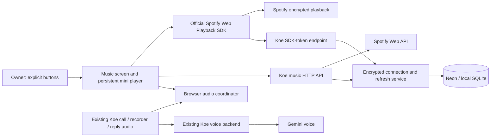
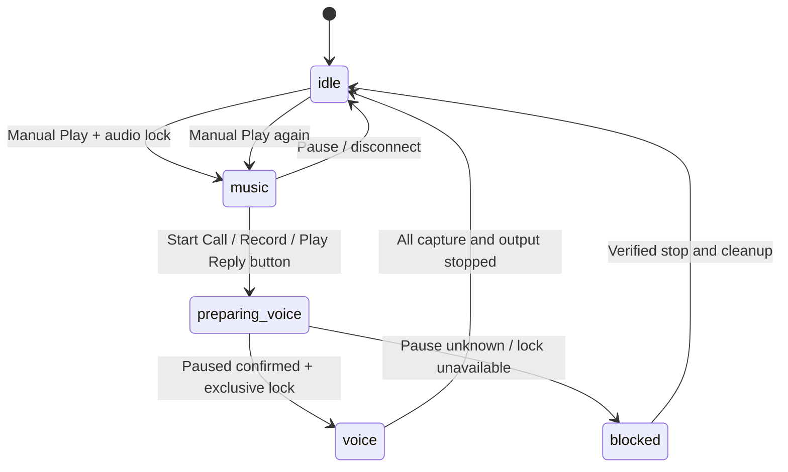

# Spotify Premium music and Koe voice: feature architecture

**Date:** 2026-10-15 (Asia/Kolkata)  
**Status:** Proposed architecture; implementation has not started.  
**Scope:** Personal Spotify Premium playback, one dedicated private playlist, and coexistence with Koe's existing voice features.  
**Owner:** Rohit's authenticated Koe account initially.  
**Budget:** Existing Spotify Premium subscription; no new paid music service or backend framework planned.

**Implementation split:** [Two-session coordination and current status](spotify/CURRENT_STATUS.md). Codex owns backend implementation; Plotcode owns frontend implementation. Those session briefs define file ownership and persistent handoffs.

## 1. Outcome and the voice-control boundary

Rohit wants his everyday Tom Frane, kanegi., keshi, indie pop, and chill music available in Koe, with a dedicated playlist and useful playback controls. Keep Spotify as the source of music and playlist truth. Keep the existing voice agent for conversation and work integrations.

There are two different requirements:

| Requirement | Architecture treatment |
|---|---|
| Listen to Spotify Premium inside Koe and manage a dedicated playlist manually | Proposed implementation described below |
| Talk to Koe while it controls Spotify, including spoken play, skip, search, or playlist edits | Not implementable under Spotify's standard developer policy; requires a separately verified permission path before planning implementation |
| Switch between listening and a Koe voice call | Proposed explicit, button-driven audio handoff, with no simultaneous audio |
| Mix music under Koe's speech, including volume ducking | Excluded |

Spotify's [Developer Policy](https://developer.spotify.com/policy), particularly sections II–IV, restricts voice-controlled Spotify applications, audio overlap, AI ingestion of Spotify content, audiovisual synchronization, and commercial streaming. Premium does not grant an exception. [Compliance Tips](https://developer.spotify.com/compliance-tips) also describes disallowed voice experiences.

**Important uncertainty:** Spotify does not explicitly approve putting a manual music player inside a voice-assistant application. Separating the controls and pausing before calls is an engineering proposal, not proof of a policy exemption. Resolve that interpretation with Spotify before enabling a live combined integration. Documentation, isolated mocks, token-boundary work, and audio coordination tests can proceed independently. If Spotify does not permit the combination, keep music in the official Spotify application and leave Koe's voice features separate; local music remains a later fallback outside this feature.

This document does not silently redefine requested voice control as supported. It defines the feasible technical design and marks the unresolved product boundary.

## 2. Scope and acceptance contract

### Included

- Connect/disconnect the owner's Spotify account independently of Google sign-in.
- Select an owned private playlist or explicitly create `Koe — Chill`.
- Display real playlist tracks, artwork, artists, and Spotify links.
- Search Spotify from a typed search field; add, remove, and reorder tracks through explicit UI actions.
- Play that playlist in the browser using the official Web Playback SDK.
- Provide play, pause, previous, next, seek, volume, shuffle, and repeat controls when supported by the current playback state.
- Pause and confirm music stopped before live calls, microphone recordings, or recorded Koe replies can use audio.
- Persist the account connection and playlist choice, while keeping playback state ephemeral.
- Handle token expiry, revoked consent, Premium errors, unavailable tracks, lost devices, browser autoplay restrictions, and quotas truthfully.

### Excluded

- Spotify tools in Gemini, text-agent, WhatsApp, voice-note, or approval tool registries.
- Automated music selection from transcripts, mood inference, or model-generated playlist decisions.
- Sending Spotify profiles, playlist contents, artwork, playback state, or listening history into model prompts or model tool results.
- Audio extraction, downloading, offline storage, recording, waveform analysis, music-driven mascot animation, crossfades, and speech mixed with music.
- Selecting or controlling speakers, phones, or other Spotify Connect devices.
- Public/collaborative playlist editing, recommendation endpoints, library-wide edits, public rollout, monetization, and multi-device coordination.

### Definition of done

The owner can connect Spotify, choose a private playlist, play an available track, change the playlist with explicit clicks, start a Koe call without application-generated audio overlap, end the call, and manually resume music. Uncertain playback or pause results remain visibly uncertain. No Spotify data enters Koe's AI channels. Existing Calendar, Sheets, Notion, GitHub, chat, and call approvals continue working.

Policy interpretation and real-account playback must be verified separately from mocked technical acceptance.

## 3. Existing Koe components and integration points

The following are observed repository components, not proposed new files:

| Component | Current responsibility | Feature integration |
|---|---|---|
| `frontend/src/App.tsx` | Hash navigation; owns `useCall` above individual pages | Add `#music`; own one music controller and audio coordinator at app level |
| `frontend/src/call/useCall.ts` | Call lifecycle; PCM receive; mic capture; WebSocket; mascot speech state | Make start asynchronous and gate it before creating voice resources; release the gate on every exit |
| `frontend/src/call/player.ts` | 24 kHz PCM voice playback and queued sources | Retain voice-only graph; explicitly flush/close on teardown |
| `frontend/src/call/mic.ts` | 16 kHz microphone stream | Start only after exclusive voice audio access is acquired |
| `frontend/src/chat/recorder.ts` | Records browser voice notes using the shared mic | Acquire the same audio gate before capture |
| `frontend/src/chat/ChatPage.tsx` | Plays stored reply audio using `HTMLAudioElement` | Route reply playback through the audio gate; stop/release on end and errors |
| `frontend/src/settings/Connections.tsx` | Account connection UI | Add Spotify connection status, reconnect, and disconnect |
| `frontend/src/session.ts`, `backend.ts` | Koe session/ticket helpers; same-origin HTTP | Reuse Koe authentication; do not treat Spotify credentials as Koe authentication |
| `backend/koe/auth.py` | Google/GitHub OAuth; owner-only HTTP access; session helpers | Reuse authenticated owner and origin validation patterns; add Spotify-specific OAuth module |
| `backend/koe/connections.py` | Encrypted per-owner connection rows and preferences | Add `spotify`; reuse encryption and preference storage |
| `backend/koe/db.py`, `backend/migrations/*.sql` | SQLite development schema and Neon schema | Add equivalent provider/flow schema changes to both backends |
| `backend/koe/main.py`, `config.py` | Router registration and backend settings | Register music/OAuth routes; optional Spotify configuration |
| `backend/koe/agent.py`, `voice_call.py`, `text_agent.py` | Shared model prompt/tools and live voice relay | No Spotify capabilities or metadata added here |
| `frontend/vite.config.ts`, `frontend/vercel.json` | `/api` and `/auth` proxies | Preserve same-origin HTTP and callback cookies |
| `frontend/public/sw.js` | Push notifications and navigation | No token, music, or audio caching added |

Current `auth.http_owner()` supports the signed-in owner or the configured development bearer token. Invited non-owner users are still rejected by `_owner_only()`. Storage being per-owner does not mean public multi-user access is available.

Spotify connection initiation requires an actual signed-in owner session. A bearer-only local session is insufficient for the browser redirect callback. Local testing must establish a real owner session on the selected development origin first.

## 4. System shape



The Spotify audio stream travels directly from Spotify to its SDK. Koe's Python backend does not proxy, decode, store, or analyze music. The model path has no edge to Spotify APIs or data.

Use existing React state, FastAPI, httpx, cryptography, and the current database layer. Load the official SDK script once; a Spotify REST wrapper package, router package, Node service, Redis, or audio mixing library is unnecessary.

### Ownership of truth

| Data | Authority | Koe's copy |
|---|---|---|
| Playlist membership/order | Spotify | Bounded, short-lived UI snapshot |
| Browser playback/device status | Spotify SDK, reconciled with targeted player API responses | Ephemeral state and last observation timestamp |
| Koe user identity | Existing Koe authentication | Server-authenticated owner context |
| Spotify account identity | `/me.account_id` | Encrypted connection payload |
| Selected playlist | Server preference scoped to owner | Validated playlist ID |
| Audio permission within Koe | Audio coordinator | Local exclusive ownership state |
| Model conversation | Existing agent system | No Spotify data appended |

## 5. Authentication and authorization

### Chosen flow: backend Authorization Code

Koe has a trusted backend capable of storing a client secret. Use Spotify's documented [Authorization Code flow](https://developer.spotify.com/documentation/web-api/tutorials/code-flow), with state bound to the current Koe session. Do not copy Google's PKCE parameters into Spotify's confidential-client flow without documentation. If the integration later becomes browser-only, use the separate [PKCE flow](https://developer.spotify.com/documentation/web-api/tutorials/code-pkce-flow) instead; never ship a client secret to the browser.

1. Owner clicks **Connect Spotify**. A same-origin authenticated POST creates a short-lived OAuth flow.
2. Backend stores a hash of random state, owner ID, a binding to the initiating Koe session, exact redirect URI, safe return path, expiry, and one-time consumption marker. Give the browser a short-lived HttpOnly flow cookie; never put credentials in return URLs.
3. Browser follows the returned Spotify authorization URL.
4. Spotify redirects to the registered callback. Backend validates the flow cookie, state, expiry, current owner/session binding, and consumes the flow atomically before exchanging the code.
5. Backend exchanges the code with Spotify, fetches `/me`, checks granted scopes, and encrypts the connection payload.
6. Browser returns to `/#music` with a bounded success/cancel/error indicator. Strip callback code/state from the final URL. Callback and token responses use `Cache-Control: no-store`.

Expired sessions, changed owners, replayed callbacks, and mismatched state reject the connection. Cancellation clears the temporary flow and preserves any previous valid connection. A restart may require a fresh connect attempt; it must never attach a flow to a different owner.

### Redirect origins

Spotify requires exact registered redirects and HTTPS, except HTTP loopback IP literals. `localhost` is not accepted. See [Redirect URIs](https://developer.spotify.com/documentation/web-api/concepts/redirect_uri).

- Production: the configured frontend HTTPS origin plus `/auth/spotify/callback`, through the existing `/auth` proxy.
- Development option A: one stable HTTPS tunnel origin, configured and registered explicitly.
- Development option B: `http://127.0.0.1:5173/auth/spotify/callback`, with Koe sign-in and same-origin checks deliberately configured for the same IP origin.
- Koe currently hardcodes `http://localhost:5173` in `auth.site()`. Using a Spotify loopback callback requires a narrow, explicit origin configuration change and matching Google callback registration if Google sign-in uses that origin. Do not infer callback URLs from arbitrary forwarding headers.
- A session cookie from `localhost` is not shared with `127.0.0.1`. Starting OAuth on one and returning to the other will fail the session binding.

### Initial scopes

| Scope | Feature reason |
|---|---|
| `streaming` | Official SDK music playback |
| `user-read-email`, `user-read-private` | Baseline requested by the official SDK web-app guide |
| `user-read-playback-state` | Check devices/active target and reconcile transfer |
| `user-modify-playback-state` | Explicit local-device transfer, playlist start, shuffle/repeat |
| `playlist-read-private` | Read the owner's dedicated private playlist |
| `playlist-modify-private` | Create/edit that playlist |

Sources: [SDK web-app guide](https://developer.spotify.com/documentation/web-playback-sdk/howtos/web-app-player), [Scopes](https://developer.spotify.com/documentation/web-api/concepts/scopes).

Do not request public/collaborative playlist or saved-library scopes in this slice. Scope expansion requires a documented feature and renewed consent.

**Permission limitation:** Spotify grants playlist permissions for the account, not for one playlist ID. Koe's backend enforces the selected-playlist boundary, but that does not downscope the Spotify token itself. The access token given to the SDK carries the granted OAuth scopes; a compromised browser could use those scopes directly until expiry. Protect against XSS, keep tokens only in memory, and never describe this as provider-enforced single-playlist access.

### Token lifecycle

- Client secret, refresh token, and encrypted connection data stay on the backend.
- The SDK receives a short-lived Spotify access token from a session-authenticated, same-origin POST endpoint; response is never cached.
- Browser memory only: no localStorage, sessionStorage, query string, service-worker cache, analytics, or transcript storage.
- Use provider `expires_in` with a short refresh margin. Access tokens currently last about an hour.
- Current Spotify documentation says Developer Dashboard refresh tokens expire six months after authorization; refreshing does not extend that authorization lifetime. Persist `authorized_at`, prompt for reconnect, and recheck this provider rule at implementation. [Refreshing tokens](https://developer.spotify.com/documentation/web-api/tutorials/refreshing-tokens).
- Serialize token refresh, reconnect, and disconnect under an owner-specific lock in the current single-process backend. Retain the prior refresh token if a refresh response omits one.
- Assign each connection a random `connection_id`. Recheck it before saving an in-flight refresh or returning a token; disconnect/reconnect invalidates older work.
- Support one backend process initially, consistent with existing caches/tickets. Multiple workers require database-coordinated refresh and invalidation before rollout.
- On invalid/revoked grant: clear the usable connection state, stop SDK playback, and show reconnect. Do not silently fall back to another owner's credentials.
- Spotify has no documented general token-revocation endpoint in this design. Disconnect deletes Koe's credentials and preferences, disconnects local SDK instances, and links to Spotify's account app-access page for provider-side removal. Already issued access tokens may remain valid until expiry or provider revocation.

## 6. Persistence and migration design

Reuse `koe_connections` with `provider = 'spotify'`. Its encrypted `token_enc` payload contains:

```text
access_token, refresh_token, expires_at, authorized_at,
spotify_account_id, spotify_user_id, connection_id
```

Use immutable `/me.account_id` for account linking, and `/me.id` only where current playlist ownership comparisons require it. Do not hardcode Premium eligibility from deprecated `/me.product`; handle the SDK's `account_error`. Sources: [May 2026 changelog](https://developer.spotify.com/documentation/web-api/references/changes/may-2026), [Profile reference](https://developer.spotify.com/documentation/web-api/reference/get-current-users-profile).

Store `spotify_playlist_id` in `koe_prefs`, scoped to owner. The selected playlist is associated with the connection generation: clear/revalidate it on account replacement. Store no listening-history profile.

Add an OAuth flow table with hashed state as primary key, owner, hashed session binding, encrypted verifier/cookie-binding material if used, exact redirect URI, safe return path, expiry, and consumed timestamp. Match current schema conventions for timestamps. Consume through an atomic conditional update; delete expired rows with bounded cleanup. OAuth flow rows contain no Spotify access/refresh tokens.

Add a durable music mutation journal keyed by `(owner_id, connection_id, request_id)`, with a request-body hash, operation kind, encrypted reconciliation evidence, timestamps, and `prepared`, `sent`, `outcome_unknown`, or `confirmed` state. Claim a prepared intent atomically and persist `sent` before making the provider request. Store the result or unknown outcome durably. Replaying an existing request returns its recorded state; reusing its ID with a different body is rejected. A crash between marking sent and actual transmission may sacrifice an action, but must never trigger an automatic duplicate send.

Every mutation carries the current connection generation; old-generation requests fail after reconnect/disconnect. Initially retain up to 1,000 journal records per connection generation and refuse new mutations when capacity is reached. Do not prune replay-protection records for an active generation merely to regain space. A later retention design needs explicit replay-expiry semantics; it is not assumed here. Resolve unknown operations before maintenance or replacing the connection. Disconnect purges Spotify-specific journal evidence as part of data deletion. This journal is operational write bookkeeping, not a listening-history or analytics store.

### Critical Neon/SQLite difference

`backend/migrations/006_usage.sql` currently constrains providers to `google`, `github`, `notion`, and `gemini`; SQLite's connection table does not have the same constraint. Merely adding Spotify to `connections.PROVIDERS` could pass local tests and fail in Neon.

Proposed migration: `backend/migrations/007_spotify_music.sql`, provided `007` is still unused when implementation begins. Preserve every existing provider and connection row, add Spotify, create the flow and mutation-journal tables, enable RLS, and revoke public access. Add equivalent schema to `backend/koe/db.py`.

**Replay hazard:** `scripts/migrate_store.py` reruns every migration in filename order. After Spotify rows exist, the old `006_usage.sql` would attempt to narrow the provider constraint before `007` runs. Make `006` replay-safe for the expanded list as well, or adopt an independently reviewed migration-ledger change. The narrow solution for this feature is to update its provider list and retain an additive `007`; do not ship only `007`. Verify a second full migration run with an existing Spotify row.

No database migration executes during HTTP requests. Applying production migrations belongs to implementation/deployment, not this document-writing task.

## 7. Proposed Koe HTTP contracts

All routes below are **new proposed Koe routes**, not existing routes or Spotify endpoints. Use typed request models, owner-only access, bounded responses, provider error redaction, and `no-store` for authentication/account responses. State-changing routes and the token route require the existing session plus an explicit same-origin check; do not assume all existing routers already enforce CSRF protection.

| Route | Request | Result |
|---|---|---|
| `POST /auth/spotify/connect` | Safe return path | Authorization URL; sets flow cookie |
| `GET /auth/spotify/callback` | Provider code/state/error | Validated exchange; redirect to music UI |
| `GET /api/music/status` | None | Connection/configuration state, selected playlist, granted capability flags; no tokens |
| `POST /api/music/sdk-token` | Connection generation | Access token, expiry, generation; SDK-only consumer |
| `GET /api/music/playlists` | Bounded cursor | Owned private playlists eligible for selection |
| `PUT /api/music/playlist` | Playlist ID | Validate ownership/privacy/read access; save selection |
| `POST /api/music/playlist` | Confirmed name; client request ID | Create private playlist; save selection after verified response |
| `GET /api/music/playlist/items` | Bounded cursor | Selected playlist snapshot and normalized items |
| `GET /api/music/search` | Typed query, limit at most 10 | Track results with Spotify links; not forwarded to AI |
| `POST /api/music/playlist/items` | Track URI, request ID | Add one track to selected playlist |
| `DELETE /api/music/playlist/items` | Exact occurrence/URI selection and expected snapshot | Remove selected occurrence(s), verified against current contents |
| `PUT /api/music/playlist/items/order` | Expected snapshot and bounded move | Reorder selected playlist |
| `POST /api/music/playback` | Explicit operation, registered SDK device ID, bounded parameters | Transfer/start selected playlist, shuffle/repeat; no arbitrary contexts/devices |
| `DELETE /api/connections/spotify` | None | Local disconnect, invalidation, preference/token deletion |

Local pause/resume/seek/previous/next/volume use SDK methods rather than redundant backend round trips. Backend Player API operations are serialized and target the current session's registered SDK device. Registration of that device must occur through the authenticated music session; a browser-provided ID alone is not evidence that it belongs to Koe. Confirm it against Spotify's devices and current session, and reject expired session/generation IDs. This limits accidental control; it is not cryptographic attestation of a Spotify device.

Playlist routes never accept a different destination playlist in a mutation body. Derive destination from the owner-scoped selection and revalidate after reconnect. Validate Spotify IDs/URIs and fixed provider hosts; do not fetch arbitrary client-supplied URLs or blindly follow upstream pagination URLs.

### Mutations and ambiguity

Music changes originate from explicit buttons, never agent-generated approval payloads. Show the exact change before commit: destination playlist, track, occurrence, or new order. Destructive/bulk actions need confirmation. Do not reuse the voice agent's approval executor to add an indirect Spotify control path.

Use snapshot/version checks where supported, particularly reorder/removal, and reject stale previews. A duplicate song may have several playlist occurrences: distinguish removing one occurrence from removing every matching URI. Verify current provider removal schema before implementing occurrence-specific deletion; if it cannot safely represent the selected occurrence, restrict the UI rather than inventing a payload.

Serialize mutations per owner/playlist and use the durable journal in section 6 to coalesce repeated request IDs across browser retries and backend restarts. Spotify does not provide a universal mutation idempotency key. On a timeout after sending create/add/remove/reorder, do not automatically retry. Reread the relevant playlist and reconcile; if the outcome cannot be established, show `outcome_unknown`. Never resend a journal entry already marked sent or unknown; human inspection is needed when reconciliation cannot prove the outcome. Do not claim provider-level exactly-once execution.

Example error envelope:

```json
{
  "error": {
    "code": "spotify_rate_limited",
    "message": "Spotify is temporarily limiting requests.",
    "retry_after_seconds": 30,
    "outcome": "not_sent"
  }
}
```

This is a proposed Koe response shape; the number is illustrative, not a measured limit. Other stable codes include `spotify_not_connected`, `spotify_scope_missing`, `spotify_reconnect_required`, `spotify_premium_required`, `spotify_device_unavailable`, `spotify_playlist_stale`, `spotify_quota_exceeded`, `spotify_unavailable`, and `spotify_outcome_unknown`.

## 8. Spotify API adapter and SDK lifecycle

### Current endpoint mapping

Read the linked official references before coding. Base URL: `https://api.spotify.com/v1`.

| Feature | Spotify endpoint |
|---|---|
| Account / eligible playlists | `GET /me`, `GET /me/playlists` |
| Create / metadata | `POST /me/playlists` with `public: false`; `GET /playlists/{id}` |
| Playlist contents and mutations | `GET`, `POST`, `DELETE`, `PUT /playlists/{id}/items` |
| Typed track search | `GET /search`, `type=track`, `limit <= 10` |
| Device evidence / transfer | `GET /me/player/devices`; `PUT /me/player` |
| Current playback / playlist start | `GET /me/player`; `PUT /me/player/play?device_id=...` |
| Shuffle / repeat | `PUT /me/player/shuffle`; `PUT /me/player/repeat`, explicitly targeted |

Sources: [February 2026 migration guide](https://developer.spotify.com/documentation/web-api/tutorials/february-2026-migration-guide), [Create Playlist](https://developer.spotify.com/documentation/web-api/reference/create-playlist), [Playlist Items](https://developer.spotify.com/documentation/web-api/reference/get-playlists-items), [Playback](https://developer.spotify.com/documentation/web-api/reference/start-a-users-playback).

Do not use obsolete `/users/{id}/playlists` creation or `/playlists/{id}/tracks` mutations. Normalize current `items`/`item` wrappers at the adapter boundary, with explicit compatibility handling for legacy response shapes if encountered. Confirm the actual payload and deletion schema against a real owned playlist; current examples and migration guidance may differ.

Bound contents to 50 items per provider request and a finite UI page/window; never fetch the entire library on app startup. Missing/unavailable/local/episode items render explicitly and cannot be treated as playable track URIs.

### SDK contract

Load `https://sdk.scdn.co/spotify-player.js` once. Install `window.onSpotifyWebPlaybackSDKReady` before script insertion; maintain one `Spotify.Player` and token callback per active music tab. Handle script already loaded, Strict Mode remounts, late callbacks, and cleanup.

Use documented methods: `connect`, `disconnect`, `getCurrentState`, `pause`, `resume`, `seek`, `previousTrack`, `nextTrack`, `setVolume`, and `activateElement`. SDK volume is 0–1. Handle `ready`, `not_ready`, `player_state_changed`, `autoplay_failed`, and initialization/authentication/account/playback errors. Honor `state.disallows`; null state is unknown, not paused. [SDK reference](https://developer.spotify.com/documentation/web-playback-sdk/reference).

On manual Play, call `activateElement()` directly in the click handler before awaiting asynchronous transfer/start. Once ready, target the SDK's actual `device_id`. Acquire audio ownership before transfer with `play:false`: Spotify documents that this preserves current playback state and does not force a pause. Confirm the intended device, then start the selected playlist context. Player API response success is not proof of audible playback; reconcile with SDK state. Never silently transfer to a phone or speaker.

Render progress with local elapsed time between state observations; do not poll Spotify every second. Reconcile on SDK changes, explicit actions, page foregrounding, and bounded recovery checks. Playback completion, disallowed actions, and device changes override optimistic UI.

Keep a small persistent player visible while music is active, including artwork/title/artist and a Spotify link. If navigation removes all playback metadata, pause instead of keeping an invisible custom music surface. The mascot stays idle during music; it does not lip-sync or react to musical beats.

## 9. Exclusive audio coordination

### Invariant

Within supported Koe sessions, only one of these may own audio at a time: Spotify playback, live voice call, microphone voice-note capture, or recorded reply playback. The coordinator prevents both speaker overlap and Spotify audio being deliberately fed to Gemini. Echo cancellation is not a substitute for pausing music.

The initial supported environment is one owner, one browser profile, one canonical Koe origin, and one audio-active tab. Use an exclusive Web Lock held for the full audio activity and a BroadcastChannel for status/explicit handoff requests. A notification alone is not a lock. If these APIs are unavailable, disable the combined experience and provide the official Spotify link; do not silently allow concurrent tabs. Other origins, browser profiles, independently controlled Spotify applications, and other devices are outside that guarantee.

For another tab holding music, a button-triggered handoff asks that tab to pause, confirm, and release its lock. A suspended/unresponsive tab does not acknowledge: block voice start with a clear recovery action. Timeout does not count as successful pause or lock release. Calls/recordings never preempt one another automatically.

### Proposed state machine



Actual state also carries owner operation ID and connection generation to ignore late results. A call's existing `connecting`, `listening`, `thinking`, and `speaking` states are all voice-active. Muting the microphone does not allow music: the assistant may still speak.

### Start-call ordering

1. A physical UI action requests voice access; set a synchronous transition guard so double clicks cannot race.
2. Disable music actions and cancel/coalesce work that has not been sent. Serialize all playback commands and establish a barrier for already-sent transfer/start operations: drain their responses or reconcile their outcomes, then issue the final pause after the last possible start. Ignoring a stale response cannot undo a Spotify command. A timeout-after-send keeps the barrier unresolved and voice blocked; do not assume a single paused observation proves no delayed start can arrive. After reconciliation, confirm a later pause before continuing.
3. Pause the local SDK if connected. Await an authoritative paused state via SDK event/current-state checks within a bounded deadline. If there has never been a music session, there is no music pause to await.
4. If state is null, unavailable, or still playing, do not open the mic. Offer retry or verified player shutdown. `disconnect()` being called is not itself positive evidence that audible playback has stopped.
5. Acquire/retain exclusive audio ownership across the complete handoff. For cross-tab transfer, wait for the previous holder's confirmed release before the new holder proceeds.
6. Only now create the voice player, authenticate/open the existing call socket, and request microphone capture.
7. If browser activation expires during the asynchronous handoff, show a second explicit Start button after music is paused. Do not bypass autoplay requirements or activate speech early just to preserve a gesture.
8. On microphone denial, network/auth error, cancellation, or late callback: stop capture, flush/close voice output, close the socket, clear transitions, then release ownership. Leave music paused.

Starting a call may never reach microphone capture or assistant output before the pause barrier succeeds. Assistant PCM playback also checks the current operation generation so stale socket frames cannot play after teardown.

### End-call ordering

Stop mic tracks/worklet, close socket, flush queued PCM sources, await AudioContext closure, release audio ownership, then re-enable manual music controls. Handle close errors with best-effort resource cleanup and visible failure where audible state remains uncertain. No automatic Spotify resume, including after failed calls.

Apply this exact gate to voice-note recording and stored voice replies. The current chat-local `nowPlaying` variable only coordinates reply clips; replace/bridge it with the app-level coordinator. Typed chat can remain available during music if it produces no automatic spoken response and receives no Spotify data.

External playback limitation: Koe cannot guarantee that a person will not manually start Spotify in a separate application during a call. The UI must not promise account-wide audio exclusivity, pause arbitrary remote devices, or record system/tab audio. For the controlled browser SDK, detect resumed music during voice ownership and pause it; suppress/stop Koe output and capture while the stop is uncertain. Test this fault path rather than assuming the SDK cannot resume externally.

## 10. UI, privacy, and operational behavior

### Music screen

Connection state, dedicated playlist selector, typed search, track list, and persistent player. Use existing accessible components/styles and hash routing. Provide keyboard controls, descriptive button labels, focus after errors, readable disabled reasons, and explicit unavailable tracks. A chosen playlist starts only after Play; loading the page never begins music.

During a call/recording/reply, show **Music paused while Koe uses audio**. Do not show a voice-command hint such as “Ask Koe to play this.” Resume is a button.

Do not claim a whole catalog is available in India merely because an artist page exists. Region, track availability, explicit filters, and account settings are checked through real responses. Initial playlist content comes from Rohit's choices, not automatically populated inferred favorites.

### Quotas and failures

Development Mode currently requires a Premium app owner and at most five allowlisted users. Nonallowlisted users can complete consent but still get 403 on API calls. [Quota modes](https://developer.spotify.com/documentation/web-api/concepts/quota-modes).

July 2026 changed app counts to 25 Client IDs per developer; quotas are shared across the developer account. Do not implement outdated “one app” assumptions. Handle `QUOTA_EXCEEDED` separately from short request throttling. [July changelog](https://developer.spotify.com/documentation/web-api/references/changes/july-2026).

Spotify publishes rolling-window rate limiting but no universal numeric request allowance. Respect `Retry-After`; debounce search, cancel stale reads, paginate lazily, and avoid repeat background refresh. Backend retries are limited to safe reads and must respect a total deadline. Never automatically replay an ambiguous mutation. [Rate limits](https://developer.spotify.com/documentation/web-api/concepts/rate-limits).

| Failure | Product behavior |
|---|---|
| Not configured / no owner session | Setup or sign-in action; existing voice app still usable |
| Premium/account error | Explain Premium requirement and reconnect/check-account action |
| Missing scopes / consent revoked | Reconnect; no fallback to shared credentials |
| SDK/DRM unsupported | Offer official Spotify link; no simulated player |
| Autoplay blocked | Explicit Play/Start interaction |
| Device lost / switched externally | Stop optimistic progress; show device unavailable; no automatic takeover |
| Rate limit / quota exhausted | Respect cooldown; retain last data as stale; distinguish unknown write outcome |
| Network disappears during pause | Block voice transition until local playback stop is verified |
| Music API unavailable | Voice can operate only when local music is known stopped; no provider reads inside the voice loop |
| App backgrounded / mobile suspended | Do not promise uninterrupted playback; reconcile on return |

### Privacy and logging

Use Spotify attribution and original artwork with links. Exclude raw provider responses from normal request logs, activity feeds, push payloads, chat history, daily logs, and AI fallback contexts. Log only operation category, outcome/error code, duration, and a non-sensitive request ID; no track titles, OAuth codes, tokens, or music preference profiles. Avoid playback-count or derived listening analytics.

Update privacy/disconnect instructions before enabling the feature. Do not persist audio. No Spotify OAuth connection or playlist creation is performed as part of architecture writing.

## 11. Proposed file ownership

| New file | Responsibility |
|---|---|
| `backend/koe/spotify_auth.py` | Session-bound connect/callback and flow lifecycle |
| `backend/koe/spotify_service.py` | Token refresh, typed provider adapter, scope and selected-playlist validation |
| `backend/koe/music_api.py` | Owner-only manual HTTP routes, durable mutation intents and bounded errors |
| `backend/migrations/007_spotify_music.sql` | Additive provider/flow/journal schema; number rechecked before creation |
| `frontend/src/music/api.ts` | Typed same-origin manual requests; no agent coupling |
| `frontend/src/music/sdk.ts` | Singleton official SDK loader, instance and documented interfaces |
| `frontend/src/music/useMusic.ts` | Playback state/actions, device registration, reconciliation |
| `frontend/src/music/MusicPage.tsx` | Dedicated playlist and typed search UI |
| `frontend/src/music/MiniPlayer.tsx` | Persistent attribution and playback controls |
| `frontend/src/music/music.css` | Responsive accessible music surface |
| `frontend/src/audio/coordinator.ts` | Exclusive local audio ownership and pause/cleanup barriers |
| `backend/tests/test_spotify_auth.py` | State replay, session binding, refresh/disconnect security |
| `backend/tests/test_music_api.py` | Playlist boundary, payload mapping, errors and mutation ambiguity |
| `frontend/tests/music.test.mjs` | Reducer/SDK adapter behavior with a controlled fake |
| `frontend/tests/audio-coordinator.test.mjs` | Ordering, races, failure barriers and cleanup |

Existing-file edits: `App.tsx`, call start/teardown, chat recorder/reply playback, Settings connections, backend configuration/router/provider registry, SQLite schema, replay-safe `006_usage.sql`, setup/privacy docs, and tests for touched call behavior. No new Spotify module in `backend/koe/tools/`.

Names and interfaces above are proposed. Match current test/module conventions during implementation; do not create empty placeholder modules in the documentation phase.

## 12. Phased implementation plan

### Phase 0 — sources, product boundary, and account readiness

**Read first:** this document; `SPEC.md`, `ACCOUNTS_SPEC.md`, `DEPLOY.md`; official policy/compliance, authorization, SDK, redirect, and current endpoint references linked above.

**Work:** Resolve the combined-app policy interpretation. Confirm whether the intended result accepts manual music controls; retain Spotify voice control as unavailable without a verified permission path. Before runtime changes, record the selected scope in `SPEC.md` and `DECISIONS.md`. Confirm owner sign-in, encryption configuration, exact callback origin, developer app access, and allowlist readiness without printing credentials.

**Verify:** A concrete list of allowed APIs/scopes and a recorded live-enablement decision. Credentials/configuration absent must be explicit, not treated as complete acceptance.

**Guard:** No voice tools, new account creation, real playlist edits, or hosting changes hidden inside documentation work. Existing user authorization and repository account-change rules govern implementation setup.

### Phase 1 — connection storage and OAuth, with mocks first

**Pattern sources:** `auth.py`'s session-bound GitHub flow, `connections.py` encryption, `db.py`, migrations `004`/`006`; Spotify Authorization Code tutorial. Copy the security properties, not provider-specific Google parameters.

**Work:** Add settings, routes, atomic flow storage, encrypted Spotify connection, origin/CSRF checks, refresh synchronization, disconnect handling, and replay-safe migrations. Add connection UI. No playback yet.

**Verify:** Wrong session/state/owner, expired/replayed callback, denied consent, missing scopes, concurrent refresh, omitted replacement refresh token, changed encryption key, and refresh/disconnect race. Run migration twice with all old providers plus Spotify present; verify SQLite and Neon behavior separately.

**Guard:** No credentials in frontend build variables, URLs, logs, or localStorage; no dependency on deprecated profile product.

### Phase 2 — SDK and manual playback

**Pattern sources:** SDK web-app guide and reference; existing app-level state; existing `/api` authentication. Use the documented SDK token callback and readiness events.

**Work:** Add SDK singleton, explicit device registration/transfer, private-playlist selection/read, player controls, attribution, current-state reconciliation, and unsupported-browser errors. Use a seeded fake SDK for browser work first.

**Verify:** One player/listener set through remounts; token refresh; null state; autoplay/account errors; stale device generation; no page-load autoplay; no remote-device fallback; real playback later on the owner account after Phase 0 is satisfied.

**Guard:** SDK audio stays outside Web Audio/mic/model pipelines. No voice or music-reactive mascot work.

### Phase 3 — complete voice/music handoff

**Pattern sources:** `useCall.ts` start/stop, `player.ts` flush, `recorder.ts`, stored reply player; the ordering in section 9.

**Work:** Add exclusive audio coordinator, call/record/reply barriers, cross-tab handoff, generation cancellation, teardown, and explicit manual resume. This phase is required before exposing music beside voice in the same enabled application.

**Verify:** A pending or rejected pause never calls `startMic`, opens assistant output, or sends microphone PCM. Double-clicks create one transition. Slow Play cannot start music during a call. Mic denial, WebSocket failure, interrupted speech, navigation/unmount, background tabs, and resumed SDK music all clean up safely. Both voice-note capture and stored replies use the same gate.

**Guard:** No ducking, spoken Spotify commands, automatic resume, or unknown-state-as-paused shortcut.

### Phase 4 — dedicated playlist editing

**Pattern sources:** Current `/items` references, migration guide, selected-playlist validation in section 7. Verify provider schemas rather than copying obsolete `/tracks` examples.

**Work:** Add typed search, explicit create/add/remove/reorder previews, durable mutation journal and atomic send claims, mutation serialization, snapshot checks, duplicate-occurrence handling, and ambiguous-outcome reconciliation.

**Verify:** Other owners/playlist destinations are rejected; public/collaborative playlists are rejected; timeout after accepted add is not retried, including after browser reload/backend restart; journal claims race safely and reject changed bodies/old generations/capacity overflow; stale reorder/removal refreshes instead of overwriting newer edits; duplicate songs are not accidentally all removed.

**Guard:** No model recommendations or broad library writes; no claim that a client request ID provides provider-side idempotency.

### Phase 5 — integrated verification and controlled enablement

**Sources:** Current official SDK/policy/API references, existing test commands, deployment/privacy guidance.

**Work:** Run changed-area tests, frontend build/lint, and full relevant regression suites. Inspect a real browser with fake responses first; then perform a bounded owner-account smoke test using an explicitly created/selected test playlist. Check network/logs for leaked data. Document measured results and remaining browser gaps in `BUILD_LOG.md`.

**Verify:** Connect, read, manual play/pause/skip/seek, playlist edit, confirmed pause-before-call, call end, manual resume, expired token, disconnect, multi-tab conflict, and backend restart. Regression-check existing work-tool approvals and voice behavior. Live playlist changes require explicit test intent; cleanup removes only records created for that test.

**Guard:** Passing mocked tests does not equal Spotify policy approval, real streaming success, or mobile-background reliability. Keep the feature off when required acceptance is incomplete.

## 13. Verification matrix and release conditions

| Area | Required evidence |
|---|---|
| OAuth isolation | Wrong session/owner and replay fail; existing owner connection survives cancellation |
| Token boundary | Refresh stays encrypted/backend-only; access token appears only in authenticated no-store response and SDK memory |
| Disconnect | In-flight refresh cannot restore a deleted connection; old generation cannot control the player |
| Database | Full migration replay with Spotify row succeeds without deleting old providers; SQLite parity verified |
| Playlist authorization | Every mutation uses the server-selected owned private playlist |
| Write uncertainty | Durable sent/unknown intent survives restart; timeout produces reconciliation or unknown status, never automatic duplicate write |
| Voice barrier | No capture/output before verified pause; no auto-resume after teardown |
| All audio entry points | Live calls, voice notes, and recorded replies acquire/release one coordinator |
| Race handling | Already-sent Play/transfer settles before final confirmed pause; repeated Start, late socket frames, external SDK resume, and cross-tab timeout tested |
| SDK behavior | One player, listener cleanup, null/disallowed states, autoplay/account/device errors covered |
| AI boundary | No Spotify tool declaration or provider data in Gemini/OpenRouter/transcripts/activity/push |
| Real account | Owner Premium, development allowlist, market availability and actual `/items` shapes verified |
| Product boundary | Spotify's treatment of combined voice app/manual player resolved before live enablement |
| Regression | Existing work integrations and their approval gates still pass |

Repository commands during implementation: `uv run pytest -q` from `backend`; `npm test`, `npm run lint`, and `npm run build` from `frontend`. Run targeted tests first, then the appropriate regression suite. This architecture task runs no real-account tests and changes no runtime behavior.

## 14. Decisions, uncertainties, and costs

### Proposed decisions

1. Official Spotify SDK for music; existing PCM pipeline for voice; no audio graph combining them.
2. Manual UI only for Spotify; no Spotify exposure to any model or voice tool registry.
3. Backend Authorization Code flow and encrypted refresh storage; browser access token in memory only.
4. One owner and one owned private playlist initially; Spotify remains the playlist authority.
5. Pause-confirm-start and teardown-before-unlock; music resumes only on an explicit click.
6. Current Neon/SQLite infrastructure, with no new runtime dependency or music storage service.
7. Personal, noncommercial scope. A public or paid Koe release needs a fresh Spotify policy/access review.

### Known unknowns

- Spotify's policy interpretation of the combined manual-player/voice-assistant product is unresolved.
- Developer app registration, owner allowlisting, and credentials have not been exercised in this task.
- Full playback, the owner's exact daily playlist, Indian-market availability, endpoint schemas, and browser/phone behavior have not been tested.
- SDK behavior after disconnect or browser suspension needs real-browser evidence; unknown audio state must never be promoted to “stopped.”
- This design does not coordinate independent Spotify apps, devices, browser profiles, or origins.

### Cost expectation

Rohit's existing Premium subscription covers the required listener subscription. Spotify's reviewed developer documentation does not publish a separate standard per-request charge for this personal integration; it does impose access and quota limits. Recheck before implementation. Existing Koe voice-model, database, and hosting usage remain separate; this feature does not make those services unlimited or free. No card-required additional service is planned.

## 15. Reference index

Official sources were checked on 2026-10-15. Re-read relevant pages at implementation time because Spotify changed several interfaces during 2026.

- [Spotify Developer Policy](https://developer.spotify.com/policy) and [Compliance Tips](https://developer.spotify.com/compliance-tips).
- [Authorization overview](https://developer.spotify.com/documentation/web-api/concepts/authorization), [Authorization Code](https://developer.spotify.com/documentation/web-api/tutorials/code-flow), [PKCE](https://developer.spotify.com/documentation/web-api/tutorials/code-pkce-flow), [Redirect URIs](https://developer.spotify.com/documentation/web-api/concepts/redirect_uri), [Refreshing tokens](https://developer.spotify.com/documentation/web-api/tutorials/refreshing-tokens).
- [Web Playback SDK getting started](https://developer.spotify.com/documentation/web-playback-sdk/tutorials/getting-started), [web-app guide](https://developer.spotify.com/documentation/web-playback-sdk/howtos/web-app-player), [SDK reference](https://developer.spotify.com/documentation/web-playback-sdk/reference), [Scopes](https://developer.spotify.com/documentation/web-api/concepts/scopes).
- [February migration guide](https://developer.spotify.com/documentation/web-api/tutorials/february-2026-migration-guide), [May changelog](https://developer.spotify.com/documentation/web-api/references/changes/may-2026), [July changelog](https://developer.spotify.com/documentation/web-api/references/changes/july-2026).
- [Current profile](https://developer.spotify.com/documentation/web-api/reference/get-current-users-profile), [Create playlist](https://developer.spotify.com/documentation/web-api/reference/create-playlist), [Playlist items](https://developer.spotify.com/documentation/web-api/reference/get-playlists-items), [Start playback](https://developer.spotify.com/documentation/web-api/reference/start-a-users-playback).
- [Quota modes](https://developer.spotify.com/documentation/web-api/concepts/quota-modes) and [Rate limits](https://developer.spotify.com/documentation/web-api/concepts/rate-limits).
- Repository context: [SPEC.md](SPEC.md), [ARCHITECTURE.md](ARCHITECTURE.md), [ACCOUNTS_SPEC.md](ACCOUNTS_SPEC.md), [TECH_STACK.md](TECH_STACK.md), [DEPLOY.md](DEPLOY.md), [DECISIONS.md](DECISIONS.md).
