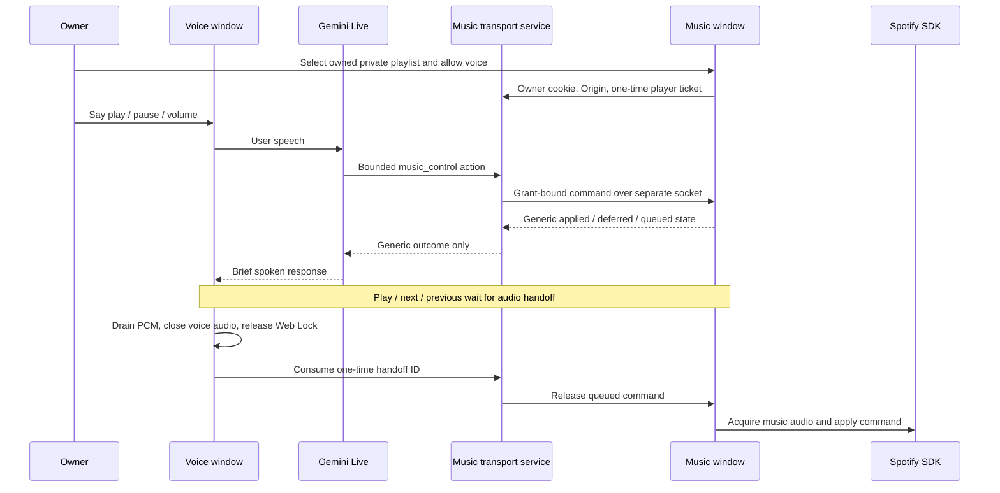

# Approved voice transport extension — 2026-10-16

**Latest implementation:** Music now embeds a compact conversational Call using the same page/player. Its explicit Call click allows/prepares the selected playlist and establishes a reconnecting control channel. `play_match` accepts user-supplied artist/title; a separate deterministic service scans the granted playlist and returns only generic matched/absent/ambiguous/unavailable outcomes to the model. A resolved position is bound to its playlist snapshot before play; missing-song suggestions go to Music search, not model catalog context. Direct manual Add is one click with idempotent inline feedback. The earlier two-window flow below is historical. Latest user instruction: publish now, skip tests/live verification; new acceptance outcomes are unverified.

The user confirmed written approval from Spotify for this use case. `SPOTIFY_VOICE_APPROVED` records that deployment decision; it defaults to false and does not verify an approval letter. Separating windows does not create an exemption from Spotify's standard prohibition. The manual Music API remains available independently. No Spotify content, audio, search result, playlist title or credential is supplied to the model by this extension.

## How it works



`music_control` exists only in the approved live web call configuration. It is absent from text chat, WhatsApp and the general agent tool list. Supported actions are `play`, `pause`, `next`, `previous`, `set_volume` (integer 0–100), `volume_up` and `volume_down` (10 percentage points, clamped). Next/previous stay within the selected playlist. Playlist creation, search and edits remain manual preview/confirm actions.

The dedicated Music page must stay open. A separate voice window opens from its **Open voice agent** link. Browser playback needs manual activation first. A request to play/next/previous during a call queues the command and ends that call after the spoken reply drains. Ordinary hang-up never resumes music. A volume change while the player is inactive is reported as deferred until playback. External Spotify apps are outside this bridge; Koe cannot confirm or pause their audio.

## Boundaries and failure handling

- Both deployment flags must be enabled. The signed-in owner explicitly grants the current connection generation and selected owned/private playlist. Reconnection, selection changes or revocation invalidate a stale grant.
- Permission and ticket routes require the owner cookie and approved Origin. Development bearer access alone cannot authorize music. The live-call ticket carries an internal one-time hashed-cookie proof without an extra HTTP request.
- `/ws/music-control` uses a single-use 30-second ticket, checks the active owner session, accepts one player per owner and checks session/grant again on heartbeat and acknowledgements. The voice caller's session is also checked before dispatch.
- Browser commands are serialized and deduplicated. Server history is bounded to 64 commands per call and 128 calls, cleared on call end. A changed body cannot reuse a command ID. The 30-second handoff ID is consumed before sending release, so a lost response cannot start music twice.
- Only enumerated states cross back to Gemini. Unknown or disconnected results are never automatically repeated. Playback failure is visible; an accepted HTTP write is not proof of audible music.
- Player tickets, sockets and replay history live in one backend process. This deployment must use one worker. A restart loses these transient grants to connected windows, so reopen Music and start a new call; persisted playlist permission alone cannot control a player. Multi-worker delivery needs a separate design before enabling it.

## Verification and live acceptance

Unit/integration tests cover strict arguments, policy/grant/session gates, ticket replay, driver replacement, revocation, duplicate/lost acknowledgements and one-time release. Real Edge tests use Vite, FastAPI, isolated SQLite, actual voice adapter, PCM queue, AudioContext closing and Web Locks. Spotify, SDK sound and Gemini function selection are simulated: these tests do not establish real speech recognition, audibility, Premium eligibility or device acceptance.

Run both browser suites with managed disposable servers from `backend`:

```powershell
.venv/Scripts/python.exe -m scripts.test_music_pipeline --node-modules 'PATH/TO/node_modules'
```

Provide an existing directory containing Playwright with installed Edge. No new project dependency is installed. The runner uses ports 8002/5176 by default, stops only its own processes and writes reports under `backend/data/spotify-e2e-browser` and `backend/data/spotify-voice-e2e-browser`. Never use fixture credentials or SDK substitutions for live acceptance.

Live acceptance: connect the owner's real account, activate playback, verify pause before microphone use, grant the playlist, speak each supported command, verify the actual device/volume/end-of-call handoff, revoke permission, and verify ordinary hang-up stays paused. Test the physical phone/browser separately. See [local setup](../../backend/SPOTIFY_LOCAL_SETUP.md).

Sources: [Spotify policy](https://developer.spotify.com/policy), [SDK setup and activation](https://developer.spotify.com/documentation/web-playback-sdk/tutorials/getting-started), [SDK reference](https://developer.spotify.com/documentation/web-playback-sdk/reference), [redirect URI requirements](https://developer.spotify.com/documentation/web-api/concepts/redirect_uri). Checked 2026-10-16.
